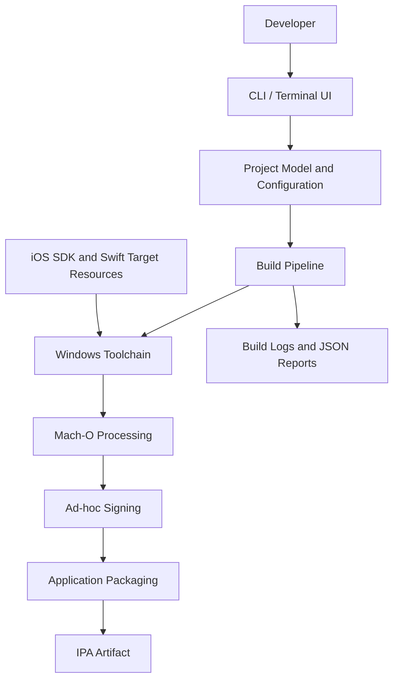
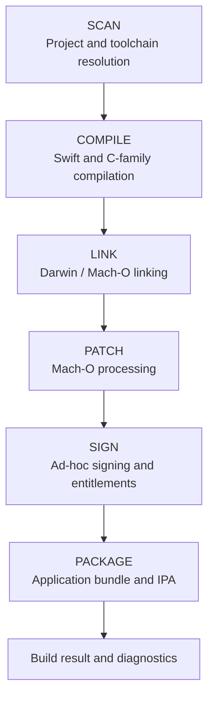
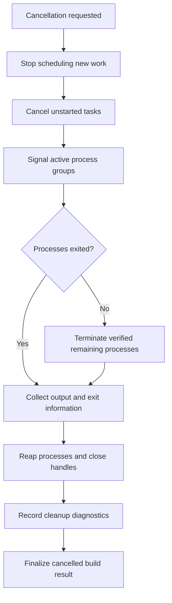

# Architecture & Technical Design

NyxWin is a Windows-hosted toolchain for cross-compiling native iOS applications.

Its architecture combines a Python application, Windows compiler tools, Apple platform SDK resources, Mach-O processing, signing and application packaging into one coordinated build workflow.

This document describes the major components, their responsibilities and the boundaries between them.

For installation and usage instructions, see [Installation & Setup](SETUP_GUIDE.md).

---

## 1. Design overview

NyxWin is built around several architectural boundaries:

- **Application interface:** CLI commands and the interactive terminal interface.
- **Project model:** Project configuration, schema validation and migration.
- **Build orchestration:** Source discovery and coordination of the build stages.
- **Toolchain integration:** Compiler, linker, SDK and runtime resolution.
- **Binary processing:** Mach-O preparation and signing.
- **Packaging:** Application bundle assembly and IPA generation.
- **Observability:** Persistent build logs, reports and cleanup diagnostics.
- **User data:** Configuration, caches, backups, SDKs and generated projects.

The intended build workflow runs directly on Windows. It does not require a macOS host, Xcode or WSL.

## 2. High-level architecture



This diagram describes the logical flow. Individual operations may involve multiple subprocesses and supporting services.

## 3. Python package organization

NyxWin uses a standard Python `src/` package layout.

The following is a conceptual map of the main implementation areas. It is not intended to be an exhaustive listing of every source file.

```text
NyxWin/
├── pyproject.toml
├── install.ps1
├── install.bat
├── src/
│   └── nyxwin/
│       ├── __init__.py
│       ├── __main__.py
│       ├── cli.py
│       │
│       ├── config/
│       │   └── paths.py
│       │
│       ├── core/
│       │   ├── project.py
│       │   └── project_migration.py
│       │
│       ├── build/
│       │   ├── compiler.py
│       │   ├── linker.py
│       │   ├── packager.py
│       │   ├── pipeline.py
│       │   ├── process_manager.py
│       │   ├── signer.py
│       │   └── transcript.py
│       │
│       ├── services/
│       │   ├── backup.py
│       │   ├── export_service.py
│       │   └── icon.py
│       │
│       ├── resources/
│       │   ├── templates/
│       │   └── tools/
│       │
│       └── tui/
│           ├── components/
│           └── screens/
│
└── docs/
```

### 3.1 Application entry points

The CLI is exposed through the package entry points configured in `pyproject.toml`.

The primary responsibilities of `cli.py` include:

- Parsing user commands and options.
- Dispatching application operations.
- Reporting errors and diagnostics.
- Connecting build operations to the terminal interface.

The package also supports module invocation through `python -m nyxwin`.

### 3.2 Project model

The project model is responsible for reading, validating and serializing application configuration.

The principal configuration file is:

```text
Config/Project.plist
```

NyxWin uses Canonical Project Schema v2.0 for its current project model.

The project migration component handles supported older configuration formats and migration into the current schema.

Project-schema migration is separate from relocation of user data between storage directories.

### 3.3 Configuration and path resolution

The path configuration layer resolves application, project and runtime-data locations.

It provides a common location-resolution boundary for:

- User configuration.
- Runtime data.
- Build workspaces.
- Compiler caches.
- Backup storage.
- Downloaded SDKs.
- Persistent build logs and reports.

Centralized path handling helps prevent application operations from accidentally targeting unrelated directories.

### 3.4 Services

Service modules implement functionality shared by multiple parts of the application.

Examples include project backup and restoration, project export, icon processing and SDK management.

The CLI and terminal interface use these services rather than duplicating their underlying operations.

### 3.5 Terminal interface

The terminal user interface provides interactive access to project management, configuration, SDK management, build progress and diagnostics.

The dashboard coordinates build-related interactions with the build pipeline.

Progress and summary components display build status, timing and relevant diagnostic information.

## 4. The six-stage build pipeline

The build orchestration is coordinated by:

```python
nyxwin.build.pipeline.build_project
```

The pipeline follows six distinct stages:

```text
SCAN → COMPILE → LINK → PATCH → SIGN → PACKAGE
```

Each stage has a separate responsibility.



### 4.1 SCAN — Project and toolchain resolution

The pipeline inspects the selected project and resolves the configuration required for the build.

This stage includes:

- Loading and validating the project configuration.
- Resolving the project name and bundle identifier.
- Reading relevant build settings.
- Resolving the target architecture and deployment target.
- Selecting the iOS SDK.
- Locating compiler, linker and runtime resources.
- Discovering source files and relevant project inputs.

The project model uses Canonical Project Schema v2.0.

When an older supported project configuration requires migration, the project migration component handles the schema transition.

### 4.2 COMPILE — Source compilation

NyxWin supports compilation of the following source languages:

- Swift.
- C.
- Objective-C.
- Objective-C++.
- C++.

Clang handles C-family compilation. Swift source is compiled using the Windows-hosted Swift toolchain.

C-family compilation tasks can be executed concurrently.

Swift compilation uses the selected iOS target and corresponding Swift platform resources.

Where a project uses a bridging header, the build system can discover supported bridging-header locations and pass the required configuration to the Swift compiler.

Additional platform support source files may also be compiled when required by the selected build configuration.

**Important distinction:** The current build system manages build workspaces and caches, but a complete dependency-aware incremental build graph is a future roadmap milestone. Do not assume that every unchanged source file is automatically reusable across arbitrary builds.

### 4.3 LINK — Mach-O linking

Compiled object files are passed to LLVM's Darwin linker.

The linker resolves references against the selected iOS SDK, including framework stubs and system libraries.

Relevant inputs include:

- Object files.
- Framework search paths.
- Library search paths.
- System library references.
- Deployment target.
- Linker flags.
- Required runtime resources.

The intended output is a 64-bit Apple Mach-O executable for the selected target architecture.

A successful link does not by itself establish that the resulting application can run on every iOS version or installation environment.

### 4.4 PATCH — Mach-O processing

The build pipeline includes a Mach-O processing step.

The bundled patcher is located at:

```text
src/nyxwin/resources/tools/patch_macho.py
```

It performs the binary transformations supported by the current implementation, including the compatibility work associated with Patch #31.

The patching operation is intended to address specific binary compatibility requirements encountered by the Windows-hosted build workflow.

Its success is determined by the patcher's validation and build result. It should not be described as a guarantee against all runtime crashes or incompatibilities.

### 4.5 SIGN — Ad-hoc signing and entitlements

NyxWin uses the bundled `ldid.exe` tool for its current ad-hoc signing workflow.

The signer operates on the application executable and the configured entitlement data.

Relevant project configuration includes:

```text
Config/Entitlements.plist
```

The entitlements selected for a build must match the intended application capabilities and installation environment.

An ad-hoc signature is not equivalent to an Apple-issued development or distribution certificate. It does not establish a normal Apple trust chain or provide standard provisioning authorization.

The final installation result depends on the target device, signing method, iOS version and installation environment.

### 4.6 PACKAGE — Application assembly and IPA creation

The packaging component assembles the application bundle and prepares the final IPA archive.

Its responsibilities include:

- Constructing the application bundle layout.
- Creating or merging application metadata.
- Including required application resources.
- Preparing the `Payload` directory.
- Creating the final `.ipa` archive.

The packager also implements deterministic archive creation.

For unchanged, already-signed application-bundle input, repeated packaging is designed to produce byte-identical IPA archives.

The deterministic packaging implementation normalizes:

- Archive entry ordering using POSIX paths.
- ZIP entry timestamps to `(1980, 1, 1, 0, 0, 0)`.
- Unix archive attributes.
- Executable and regular-file permission bits.
- Exclusion of specified operating-system and temporary files.

The output is written through a temporary sibling file and replaces the destination only after successful packaging.

The reproducibility claim applies to equivalent inputs and build conditions. It does not imply that separate compilation runs always produce identical signed application bundles.

## 5. Build observability and reporting

The observability subsystem records build activity independently from the terminal display.

Its main implementation is:

```text
src/nyxwin/build/transcript.py
```

For managed Windows installations, persistent build artifacts are stored under:

```text
%LOCALAPPDATA%\NyxWin\Logs\builds\<Project>\
```

The directory can contain:

```text
<build_id>.log
latest.log
<build_id>.json
build_report.json
```

### 5.1 Text logs

The build-specific text log records human-readable activity from the build.

The `latest.log` file provides convenient access to the most recent build transcript.

### 5.2 Structured JSON reports

Each build also produces a structured JSON report.

Depending on the build result, the report records information such as:

- Build identifier and project metadata.
- Build status.
- Start and finish timestamps.
- Total build duration.
- Individual pipeline stage timings.
- Toolchain information.
- Command invocations and exit codes.
- Warning and error diagnostics.
- Process cleanup results.
- Final artifact information where available.

The build report format is versioned independently from the project configuration format.

| Schema | Purpose |
|---|---|
| Canonical Project Schema v2.0 | Describes project configuration |
| Build Report JSON Schema v1.0 | Describes structured build reports |

These are separate formats with different responsibilities.

### 5.3 Persistent report writing

The transcript subsystem uses temporary files and replacement operations when writing persistent records.

This reduces the risk of leaving a partially written report at its final destination after an interrupted write.

Build-specific records and convenience copies serve different purposes: one preserves the history of a particular build, while the other provides access to the most recent result.

## 6. Windows process management and cancellation

Build tools such as compilers and linkers run as external processes.

The process management subsystem coordinates their execution, output collection and termination.

Its implementation is located at:

```text
src/nyxwin/build/process_manager.py
```

The current design includes:

- Isolated Windows process groups.
- Tracking of relevant descendant processes.
- Process identity validation using creation-time information.
- Graceful cancellation signals.
- Targeted forced termination when graceful termination fails.
- Bounded subprocess output collection.
- Process reaping and handle cleanup.
- Cleanup diagnostics recorded in the build report.

The process identity checks help protect against PID reuse: a process identifier alone is not sufficient evidence that a process is still the same process originally started by a build.

### 6.1 Cancellation flow

Cancellation can be requested through the supported CLI or TUI interaction.

The general sequence is:



### 6.2 Timing and cleanup

The accepted Stage 1 implementation documented the following default timing boundaries:

| Operation | Default bound |
|---|---:|
| Graceful termination window | 0.5 seconds |
| Descendant handle wait | 500 milliseconds |
| Root process reap | 2 seconds |
| Concurrent worker join ceiling | 3.5 seconds |
| Bounded stream collection wait | 1 second |

These are implementation limits for the documented process-management workflow, not a guarantee that every operating-system operation or external tool will finish within those periods.

### 6.3 Outcome classification

Build outcomes distinguish successful completion, failure and cancellation.

Cleanup warnings and unreaped processes are recorded rather than silently treated as success.

A cancelled build must not be reported as successful merely because an earlier build stage completed.

## 7. TUI integration

The interactive terminal interface presents build progress and results.

Its build-related components include the dashboard and progress display.

The TUI provides:

- Project selection.
- Build initiation.
- Live build progress.
- Stage-level status and timing.
- Cancellation interaction.
- Distinct build result states.
- Access to persistent build evidence.

Supported cancellation keys during an active build include `Esc` and `Q`.

After a build completes, the supported report viewer can be opened using `J` from the build summary.

The report viewer provides:

| Key | Action |
|---|---|
| `N` | Next page |
| `P` | Previous page |
| `Y` | Copy report path |
| `O` | Open the JSON report |
| `C` | Copy report contents |
| `Esc` | Return to the build summary |

The actual available actions depend on the active interface and installed NyxWin version.

## 8. Storage architecture

NyxWin separates application files from mutable user data.

The standard managed Windows layout uses:

```text
%LOCALAPPDATA%\NyxWin/
├── app/
├── bin/
├── SDKs/
├── Build/
├── Cache/
├── Backups/
├── Logs/
└── Settings/
```

User configuration is stored under:

```text
%APPDATA%\NyxWin\
```

The default project location is:

```text
%USERPROFILE%\NyxProjects\
```

The following environment variables can override relevant locations:

- `NYXWIN_CONFIG_DIR`
- `NYXWIN_DATA_DIR`
- `NYXWIN_PROJECTS_DIR`
- `NYXWIN_SDK_DIR`

Centralizing data outside the application source directory reduces coupling between application updates and user projects.

### 8.1 Legacy data

Earlier layouts may contain projects, SDKs, caches and backups inside the repository.

NyxWin provides inspection and migration operations for supported legacy data.

Data relocation and project-schema migration are separate operations.

The migration workflow is designed to avoid overwriting destination files and to preserve source data. Important projects should still be independently backed up and verified before and after migration.

See [Data Storage & Migration](DATA_MIGRATION.md).

## 9. Filesystem and operational safety

The application includes defensive measures around project paths, archives, backups and generated files.

Relevant protection areas include:

### Path validation

Operations that remove or modify managed build directories must validate that their target paths remain within the intended root.

This helps prevent accidental operations outside the configured workspace.

### Archive extraction

Backup restoration must validate archive entry paths before writing extracted files.

Archives containing traversal paths must not be allowed to write outside the intended restoration destination.

### Backup and recovery

Backup creation and restoration are separate operations.

A restoration workflow should preserve an independently recoverable version of the project before replacing existing contents.

### Temporary-file handling

Build and packaging operations use temporary output paths where appropriate.

Temporary files should not replace a previously completed deliverable unless the new operation reaches its successful completion condition.

### External processes

Managed build tools are executed through the process management boundary so their output, exit state and cleanup can be recorded.

## 10. Signing and compatibility boundaries

NyxWin's build pipeline creates application packages using its configured signing workflow.

However, several different concepts must not be confused:

- A Mach-O executable is not an IPA.
- An IPA archive is not proof of a valid trusted signature.
- An ad-hoc signature is not an Apple-issued signing identity.
- An entitlement value does not automatically grant the corresponding system capability.
- A successful build does not guarantee successful installation or execution.

Device compatibility must be verified for the specific iOS version, device and installation environment.

Manual and automated device tests should be reported separately, with the actual environment and limitations recorded.

## 11. Development boundaries and future work

The current architecture provides project management, build orchestration, packaging, diagnostics and Windows process cleanup.

The following work remains part of the future roadmap rather than the completed build pipeline:

- Dependency-aware build tracking and sound caching.
- Incremental build graph scheduling.
- Static library and XCFramework integration.
- Expanded resource and localization support.
- Swift Package Manager feasibility and integration.
- SourceKit-LSP and IDE integration.

These capabilities should be introduced without weakening the existing build lifecycle or making macOS or WSL a required dependency.

See [Roadmap & Development](ROADMAP_AND_ENHANCEMENTS.md).

---

## 12. Related documentation

- [README](../README.md)
- [Installation & Setup](SETUP_GUIDE.md)
- [CLI Reference](COMMANDS.md)
- [Windows Dependencies](WINDOWS_DEPENDENCIES.md)
- [Data Storage & Migration](DATA_MIGRATION.md)
- [Build & Release](BUILD_AND_RELEASE.md)
- [Troubleshooting](TROUBLESHOOTING.md)

## 10. Licensing and component separation

NyxWin maintains a strict separation between its original Python application codebase and bundled third-party tools:

1. **Original Application Code (PolyForm Noncommercial 1.0.0):**
   - The core Python package (`src/nyxwin/`) and documentation are original works owned by the project owner and licensed under the PolyForm Noncommercial License 1.0.0.
   - Community developers are permitted to inspect, run, modify, fork, and distribute this code for personal and non-commercial purposes.
   - Commercial licensing authority is reserved exclusively to the project owner.

2. **Bundled Third-Party Executables & Libraries (Separate Licenses):**
   - External executables (such as `ldid.exe`) and compiler runtime archives (`libclang_rt.ios.a`) are governed by their respective upstream licenses (GNU GPLv3 / GNU AGPLv3, and Apache 2.0 with LLVM Exception).
   - These components are not relicensed under PolyForm and are distributed with their applicable upstream notices in `src/nyxwin/resources/tools/`.
