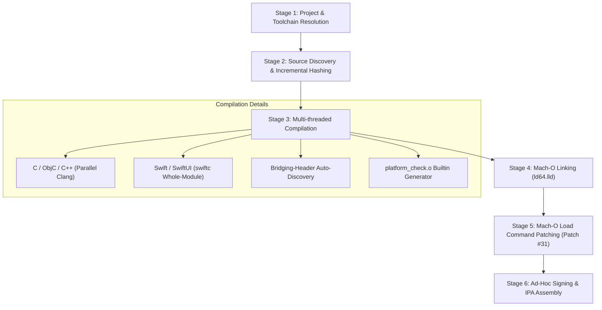

# NyxWin Architecture and Technical Design

## 1. Executive Summary

NyxWin is a high-performance, native Windows-hosted iOS build toolchain and packaging system. It enables developers on Windows 10/11 x64 to compile, link, patch, ad-hoc sign, and package native iOS applications (C, C++, Objective-C, Swift, and SwiftUI) into valid `.ipa` bundles without requiring macOS, Xcode, virtual machines, or the Windows Subsystem for Linux (WSL).

---

## 2. Package Architecture (`src/nyxwin`)

NyxWin is structured as a standard Python package following modern packaging specifications (`pyproject.toml`, console scripts, standard `src/` layout).

```
NyxWin/
├── pyproject.toml              # Modern package manifest and console script endpoints
├── nyx.bat / nyxwin.bat        # Canonical Windows batch launchers
├── main.py                     # Single root launcher script (CLI & TUI)
├── src/nyxwin/
│   ├── __init__.py             # Version metadata (__version__ = "1.0.0")
│   ├── __main__.py             # Module entry point: python -m nyxwin
│   ├── cli.py                  # Single canonical CLI dispatcher (argparse)
│   ├── application.py          # Unified application runtime orchestrator
│   ├── config/
│   │   ├── __init__.py
│   │   └── paths.py            # Central path resolution & safe subpath validator
│   ├── core/
│   │   ├── __init__.py
│   │   ├── models.py           # ANSI terminal styling, banners, logging primitives
│   │   ├── paths.py            # Path re-export for backwards compatibility
│   │   ├── project.py          # Project.plist parser & macro expander
│   │   ├── workspace.py        # Single/multi workspace discovery & history
│   │   ├── toolchain.py        # Compiler, linker, runtime & SDK discovery
│   │   └── diagnostics.py      # Clang & Swift error formatting engine
│   ├── build/
│   │   ├── __init__.py
│   │   ├── compiler.py         # Multi-threaded C/ObjC compilation, Swift compilation
│   │   ├── linker.py           # ld64.lld Mach-O linker argument builder
│   │   ├── patcher.py          # Native Mach-O load command patcher (Patch #31)
│   │   ├── signer.py           # ldid ad-hoc code signer & recursive type-sensitive validator
│   │   ├── transcript.py       # Deterministic, persistent build transcript engine
│   │   ├── packager.py         # Payload assembly, Info.plist generator, IPA archiver
│   │   ├── assets.py           # .xcassets flattener & loose icon extractor
│   │   └── pipeline.py         # Build pipeline coordinator (build_project)
│   ├── services/
│   │   ├── __init__.py
│   │   ├── backup.py           # Zip snapshot creator, restore with safety backup
│   │   ├── icon.py             # Pillow LANCZOS icon scaler + PowerShell fallback
│   │   ├── sdk_manager.py      # xybp888/iOS-SDKs scraper & extractor
│   │   ├── migration.py        # Non-destructive legacy data migration engine
│   │   └── git_service.py      # Per-project git status inspection & init
│   ├── resources/              # Authoritative immutable package assets
│   │   ├── templates/          # Scaffolding templates (SwiftUI, UIKit, C, C++, ObjC)
│   │   └── tools/              # ldid.exe, libclang_rt.ios.a, patch_macho.py, platform_check.c
│   └── tui/
│       ├── __init__.py
│       ├── terminal.py         # msvcrt raw keyboard handler & clear/header utilities
│       ├── menu.py             # Viewport scrolling interactive selection prompt
│       └── screens/
│           ├── __init__.py
│           ├── dashboard.py    # Main studio dashboard & project launcher
│           ├── config_screen.py# Visual plist editor & entitlement toggles
│           ├── sdk_screen.py   # Interactive SDK downloader & manager
│           ├── backup_screen.py# Project snapshot & restoration manager
│           └── diagnostics_screen.py # Live diagnostic logs viewer
│       ├── components/         # Boxed layouts, progress indicators, input prompts
│       └── theme.py            # Consistent ANSI theme palette & path truncator
├── tests/                      # Automated test suite (195+ unit & integration tests)
├── docs/                       # Architecture, commands, migration & guides
└── tools/                      # Developer testing & verification utilities
```

---

## 3. The 6-Stage Compilation & Packaging Pipeline

When `nyx build <Project>` is invoked, the request is coordinated by `nyxwin.build.pipeline:build_project` through six dedicated stages:



### Stage 1: Project & Toolchain Resolution
1. Loads and validates `Config/Project.plist` conforming to the native Project Schema v1.0.
2. Resolves target triple (default: `arm64-apple-ios17.0`) and active iOS SDK.
3. Expands macro variables (`$(SDKROOT)`, `$(CACHEROOT)`, `$(ExecutableName)`, `$(DeploymentTarget)`).

### Stage 2: Source Discovery & Incremental Hashing
1. Recursively enumerates source files (`.c`, `.m`, `.mm`, `.cpp`, `.swift`), ignoring non-code directories (`Config`, `Resources`, `.git`, `Cache`, `Output`).
2. Computes SHA-256 hashes for all sources against `Cache/<Project>/build_manifest.json`.
3. Auto-detects SwiftUI requirements: if `import SwiftUI` is present, `SwiftUI`, `UIKit`, and `SwiftUICore` are automatically scheduled for linkage.

### Stage 3: Multi-threaded Compilation
1. **C / Objective-C / C++**: Compiled concurrently across all CPU cores using `ThreadPoolExecutor`. Unmodified source files are served instantly from cache (`[CACHED]`).
2. **Swift / SwiftUI**: Compiled via `swiftc.exe` using Whole-Module Optimization (`-whole-module-optimization -parse-as-library`).
3. **Objective-C Bridging Header**: Auto-discovered via `find_bridging_header` in project root, `Config/`, or `Source/`, automatically injecting `-import-objc-header`.
4. **Platform Version Helper**: Automatically compiles `platform_check.c` (providing `__isPlatformVersionAtLeast` and `__isOSVersionAtLeast`) to resolve dynamic availability symbols.

### Stage 4: Mach-O Linking
1. Invokes LLVM's Mach-O linker `ld64.lld.exe`.
2. Passes `-syslibroot <SDK>`, framework paths (`-F`), and `-dynamic -pie`.
3. Injects universal ARM64/ARM64e `libclang_rt.ios.a` compiler-rt runtime archive.
4. Generates unpatched 64-bit Mach-O binary (`MH_MAGIC_64`).

### Stage 5: Mach-O Load Command Patching (Patch #31)
1. Swift applications utilizing modern SwiftUI frameworks on iOS 17+ reference dynamic symbols from `SwiftUICore` requiring chained fixups or specific load commands.
2. `nyxwin.build.patcher:patch_macho_binary` parses Mach-O headers, iterates through `load_command` entries, and applies in-place binary transformations to ensure zero-crash execution on iOS devices.

### Stage 6: Code Signing, Payload Packaging & IPA Assembly
1. **Ad-Hoc Signing**: Invokes `ldid.exe -S<Entitlements.plist>` to sign binary and embed entitlements (supporting TrollStore root entitlements or standard sandboxed profiles).
2. **Payload Assembly**: Creates standard iOS `.app` layout in `Payload/<Project>.app`.
3. **Info.plist Generation**: Generates or merges `Info.plist` with expanded bundle identifiers and version numbers.
4. **Asset Flattening**: Copies icons and flattens `.xcassets` directories into root application resources.
5. **ZIP Compression**: Packages the `Payload/` folder into `<Project>.ipa` stored inside the project `dist/` directory (`<ProjectDir>/dist/<Project>.ipa`).

---

## 4. Security & Path Safety Architecture

The refactored codebase incorporates defensive hardening against common filesystem and execution vulnerabilities:

| Risk Category | Previous Vulnerability | Hardened Implementation |
|---|---|---|
| **Path Traversal in Cache** | `shutil.rmtree(cache_dir / project_name)` allowed escaping cache root with `../../` | Guarded by `is_safe_subpath` checking strict ancestor containment |
| **Zip-Slip in Backup Restore** | `zipfile.extractall()` vulnerable to malicious path headers (`../../evil.txt`) | Each entry is verified to ensure canonical destination stays inside project directory |
| **PowerShell Code Injection** | Icon generation formatted raw paths into PowerShell code strings | Replaced with native Pillow LANCZOS scaling; fallback passes paths via parameterized CLI args |
| **Subprocess Arguments** | Shell quoting issues on Windows | All compiler, linker, and signer commands use list-based arguments with `shell=False` |
| **Accidental Project Loss** | Interactive project deletion had no rollback | Automatically creates safety backup snapshot before project deletion or backup restore |

---

## 5. Storage Layout & Data Migration

NyxWin cleanly decouples immutable application source code from mutable user runtime data:

- **Immutable Package**: `src/nyxwin` and packaged templates/tools.
- **User Configuration & Settings**: `%LOCALAPPDATA%\NyxWin\Settings` (stores global configuration and `recent_projects.json`).
- **Runtime Data & Build Intermediates**: `%LOCALAPPDATA%\NyxWin` (stores compiler caches under `Cache/`, external build intermediates under `Build/`, snapshots under `Backups/`, logs under `Logs/`, and downloaded SDKs under `SDKs/`).
- **Default Standalone Projects**: Dedicated project directories created by the user (each project is self-contained with its own `Config/Project.plist` and `dist/<App>.ipa`).
- **Legacy Preservation**: Existing repository directories (`Projects/`, legacy `Project.plist` in project root) remain supported backward-compatibly without destroying data.

---

## 6. Standalone Executable Readiness

The application is structured to enable packaging into a single `nyx.exe` standalone binary in the future (e.g. using PyInstaller) without modifying any business logic:
- Entry point `nyxwin.cli:main` has zero global side effects on import.
- Resource discovery (`paths.py`) supports frozen package environments (`sys._MEIPASS`).
- Heavy external dependencies (iOS SDKs and LLVM binaries) remain external toolchain assets, keeping the core launcher compact (<15MB).
