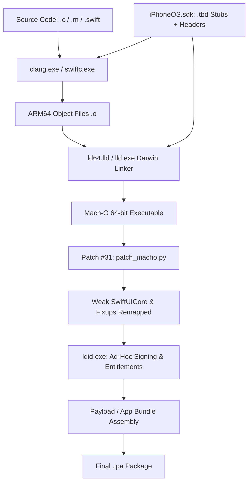

# NyxWin Setup & Installation Guide
### Native iOS Toolchain & IPA Builder for Windows (Strictly No macOS & No WSL)
**Developed by Abdo AT ([@xAbdoAT](https://github.com/xAbdoAT))**

Welcome to **NyxWin**, the native Windows toolchain and build engine created by **Abdo AT** that compiles C, Objective-C, and Swift/SwiftUI iOS applications directly into unsigned or ad-hoc signed `.ipa` packages ready for iPhone installation via **TrollStore**, **LiveContainer**, **RootHide Jailbreak**, or sideloading tools.

---

## 1. Architecture Overview: How Windows Compiles iOS Apps

Historically, iOS development required macOS and Xcode. NyxWin eliminates this requirement by leveraging the cross-compilation capabilities of modern LLVM and Swift:



### Key Components
1. **Compiler (`clang.exe`)**:
   LLVM's Clang natively supports Apple targets. Passing `-target arm64-apple-ios17.0 -isysroot <path/to/sdk>` compiles C and Objective-C (`-fobjc-arc`) directly into ARM64 Mach-O object files.
2. **Swift Compiler (`swiftc.exe`)**:
   The official Swift toolchain for Windows supports cross-compilation to Apple platforms using `-target arm64-apple-ios17.0 -sdk <path/to/sdk>`.
3. **Linker (`ld64.lld` / `lld.exe -flavor darwin`)**:
   LLVM's multi-target linker includes the Darwin Mach-O driver. It reads Apple `.tbd` (Text-Based Dynamic Library) text stubs from the iOS SDK to resolve symbols from UIKit, Foundation, SwiftUI, and libSystem without needing heavy Mach-O dynamic libraries.
4. **Mach-O Patcher (`patch_macho.py`) - Patch #31**:
   iOS 17+ dyld expects certain Swift symbols from `SwiftUICore.framework` instead of `SwiftUI.framework`. On Windows, the linker defaults to a direct load. `patch_macho.py` inspects the Mach-O load commands, transforms `LC_LOAD_DYLIB` for `SwiftUICore` into `LC_LOAD_WEAK_DYLIB` (`0x80000018`), and updates the `LC_DYLD_CHAINED_FIXUPS` import table so the resulting app launches cleanly on iOS without crashing.
5. **Ad-Hoc Signer & Entitlements Injector (`ldid.exe`)**:
   Link Identity Editor (ldid) injects the `LC_CODE_SIGNATURE` Mach-O load command and embeds the XML entitlements (`platform-application: true`, `no-sandbox: true`) needed for TrollStore.
6. **Package Builder (`nyxwin.build.packager`)**:
   Orchestrates payload structure, Info.plist generation, resource inclusion, and ZIP packaging into the final installable `.ipa`.

---

## 2. System Requirements

- **Operating System**: Windows 10 (Build 19041+) or Windows 11 (64-bit x64).
- **Python**: Version 3.10 or higher.
- **Git**: Installed and available in PowerShell / CMD.
- **Disk Space**: ~3 GB free for LLVM, Swift Toolchain, and iOS SDK.

---

## 3. Installation

### Option A: One-Line Automated PowerShell Install (Recommended)
Run the following command in PowerShell to automatically download NyxWin into `%LOCALAPPDATA%\NyxWin\app`, install all dependencies (Python, LLVM, Swift, iOS SDK, Swift target resources), and configure global `nyx` and `nyxwin` commands in `%LOCALAPPDATA%\NyxWin\bin`:
```powershell
irm https://raw.githubusercontent.com/xAbdoAT/NyxWin/main/install.ps1 | iex
```

To check for updates or update NyxWin at any time:
```powershell
nyx update          # Update from latest stable GitHub Release
nyx update --dev    # Update from latest commit on main branch
nyx update --check  # Check if an update is available
```

---

### Option B: Manual Step-by-Step Installation

#### Step 1: Install Python (if not already installed)
In PowerShell:
```powershell
winget install Python.Python.3.12
```

#### Step 2: Install LLVM (Clang & LLD)
LLVM provides `clang.exe` and `lld.exe`:
```powershell
winget install LLVM.LLVM --silent --accept-package-agreements --accept-source-agreements
```
> **Verification**:
> Close and reopen PowerShell, then run:
> ```powershell
> clang --version
> lld --version
> ```

#### Step 3: Install Swift for Windows (Required for Swift/SwiftUI)
Install the official Swift Toolchain:
```powershell
winget install Swift.Toolchain --silent --accept-package-agreements --accept-source-agreements
```
*Alternatively, download the official installer directly from [swift.org/install/windows](https://www.swift.org/install/windows/).*

> **Verification**:
> ```powershell
> swiftc --version
> ```

#### Step 4: Clone the NyxWin Repository
```powershell
git clone https://github.com/xAbdoAT/NyxWin.git
cd NyxWin
powershell -ExecutionPolicy Bypass -File .\install.ps1
```

### Step 5: iOS SDK Setup & Management
NyxWin includes a built-in SDK manager that downloads official pre-built SDKs directly from [xybp888/iOS-SDKs](https://github.com/xybp888/iOS-SDKs):

```powershell
# List installed and available SDKs
nyx sdk list

# Download and install any SDK version (e.g., 26.5, 27.0)
nyx sdk install 26.5
```

By default, NyxWin uses `iPhoneOS26.5.sdk` (iOS 17.5) for peak stability on TrollStore devices, but you can build against any SDK:
```powershell
nyx build MyApp --sdk 27.0
```

### Step 6: Verify Ad-Hoc Signer (`ldid.exe`)
NyxWin includes a pre-compiled native Windows 64-bit `ldid.exe` in `tools/ldid.exe`.
To verify it runs:
```powershell
.\src\nyxwin\resources\tools\ldid.exe -h
```
If you ever need to update `ldid.exe`, download `ldid_w64_x86_64.exe` from [ProcursusTeam/ldid releases](https://github.com/ProcursusTeam/ldid/releases) and place it in `tools/ldid.exe`.


---

## 4. Environment Verification (`nyx-win doctor`)

Run the built-in diagnostic tool to check your environment:
```powershell
nyx doctor
```

Example healthy output:
```text
Checking NyxWin Toolchain Environment...

  [OK] Clang Compiler:      C:\Program Files\LLVM\bin\clang.exe
       Version: clang version 23.1.4
  [OK] LLVM Linker (lld):   C:\Program Files\LLVM\bin\lld.exe
  [OK] Mach-O Linker (ld64): C:\Program Files\LLVM\bin\ld64.lld.exe
  [OK] Swift Compiler:      C:\Program Files\Swift\Toolchains\default\usr\bin\swiftc.exe
  [OK] iOS SDK:             C:\...\NyxWin\sdk\iPhoneOS26.5.sdk (277 frameworks verified)
  [OK] Code Signer (ldid):  C:\...\NyxWin\tools\ldid.exe
  [OK] Mach-O Patcher:      C:\...\NyxWin\tools\patch_macho.py (Patch #31)

----------------------------------------------------------------------
[SUCCESS] All tools installed! Ready to compile C, Objective-C, and Swift/SwiftUI apps for iOS on Windows.
```

---

## 5. Usage Guide: Building Your First iOS App

### Creating a New Project
NyxWin comes with 2 production Swift application templates:

1. **SwiftUI Application (Swift)**:
   ```powershell
   nyx new swiftui MySwiftUIApp
   ```
2. **UIKit Application (Swift)**:
   ```powershell
   nyx new swift-uikit MyUIKitApp
   ```

### Project Structure
Each project has the following layout:
```text
MySwiftUIApp/
├── Config/
│   ├── Project.plist       # Project configuration (frameworks, flags, bundle id)
│   ├── Info.plist          # iOS bundle metadata
│   └── Entitlements.plist  # TrollStore / sandbox entitlements
├── ContentView.swift       # Swift / SwiftUI source code
├── MySwiftUIAppApp.swift   # Main app entry point
└── Resources/              # Icons, assets, and images
```

### Compiling and Packaging the IPA
To compile the project and build the `.ipa`:
```powershell
nyx build MySwiftUIApp
```

Verbose build mode (shows exact compiler and linker commands):
```powershell
nyx build MySwiftUIApp --verbose
```

### Cleaning Build Artifacts
```powershell
nyx clean MySwiftUIApp
```

---

## 6. Installing on your iPhone

The generated `.ipa` is located in `<ProjectDir>/dist/<ProjectName>.ipa`.

### Physical Device Verification Context
During development and verification, live device testing was performed on:
- **Device Model:** Physical iPhone XS
- **Operating System:** iOS 17.0
- **Environment:** RootHide jailbreak with AppSync Unified (`amfid` / `MobileInstallation` patch)
- **Installation Method:** Automated USB installation via `mcp-appinst`

> [!NOTE]
> The automated device tests exercised ad-hoc pseudo-signed binaries on a jailbroken device with AppSync Unified. TrollStore (`trollstorehelper`) was **not** invoked during those specific automated test runs, and no Apple Developer provisioning profile was attached.

### Deployment Options for End Users

1. **Jailbroken Devices (with AppSync Unified)**
   - Ad-hoc signed IPAs can be installed directly over USB or via file sharing without Apple certificate signing.

2. **TrollStore (iOS 14.0 – 17.0 CoreTrust)**
   - Transfer `<ProjectName>.ipa` to the device (AirDrop, iCloud Drive, or local HTTP server).
   - Open the IPA in TrollStore to install with persistence and rootless capabilities.

3. **Standard Sideloading (AltStore / Sideloadly / Sideloading Tools)**
   - Requires re-signing the IPA with a personal Apple ID (7-day free profile) or Apple Developer Certificate.
   - Ad-hoc pseudo-signatures produced by `ldid` cannot run on stock, un-jailbroken iOS devices without an Apple trust chain or CoreTrust bypass.

---

## 7. Troubleshooting & FAQ

#### Q: Linking fails with `unknown argument: -flavor darwin`
**Fix**: Ensure your `lld.exe` is from LLVM 15+. Modern LLVM includes `ld64.lld.exe` alongside `lld.exe`. NyxWin automatically detects and uses `ld64.lld.exe` if present.

#### Q: Clang cannot find standard C headers (`stdio.h`)
**Fix**: Verify your SDK path with `nyx doctor` (or `python main.py doctor`). The SDK must contain `usr/include`.

#### Q: How do I add custom frameworks (e.g. `AVFoundation`, `CoreGraphics`)?
**Fix**: Open `Config/Project.plist` in your project folder and add the framework name to the `Frameworks` array:
```xml
<key>Frameworks</key>
<array>
    <string>Foundation</string>
    <string>UIKit</string>
    <string>AVFoundation</string>
</array>
```
NyxWin will automatically link the appropriate `.tbd` stubs during the build step.
