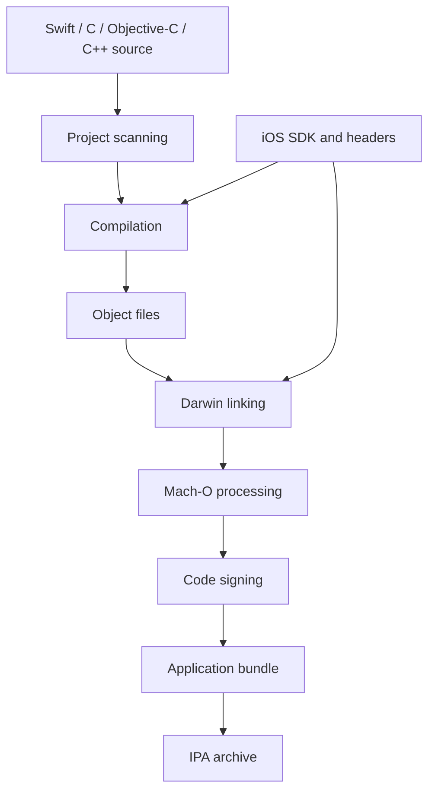

# Installation & Setup

**Build native iOS applications on Windows.**

NyxWin is a Windows-based cross-compilation toolchain for building iOS applications using Swift, SwiftUI, UIKit, C, Objective-C and C++.

The intended workflow runs directly on Windows. It does not require a macOS host, Xcode or WSL.

> **Project status:** NyxWin v1.1.0 is the current public release. Supported configurations can still change in later releases.

> **Important:** NyxWin is an independent cross-compilation project, not an Apple-supported replacement for Xcode. Generating an IPA does not guarantee that the application can be installed or launched on every iOS device.

---

## 1. How it works

NyxWin coordinates the compilation and packaging tools needed to produce an iOS application.

The build process follows six stages:

```text
SCAN → COMPILE → LINK → PATCH → SIGN → PACKAGE
```

At a high level:



The toolchain brings together:

- **Swift compiler:** Compiles Swift and SwiftUI source code.
- **Clang:** Compiles C, Objective-C and C++ source code.
- **Darwin linker:** Resolves Apple platform symbols and produces Mach-O executables.
- **iOS SDK:** Provides the headers and framework stubs required for Apple platform targets.
- **Mach-O processing:** Applies the binary adjustments required by the current build pipeline.
- **Code signing and packaging:** Prepares the application bundle and produces an IPA archive.

For the implementation details, see [Architecture & Pipeline Design](ARCHITECTURE.md).

---

## 2. System requirements

The following is the intended development environment for the current Windows toolchain.

| Component | Requirement |
|---|---|
| Operating system | Windows 10 or Windows 11, 64-bit x86 |
| Python | 3.10 or newer, subject to the installed NyxWin release requirements |
| Git | Git for Windows, required for source-based installation |
| LLVM | Compatible Windows builds of Clang and LLD |
| Swift | A compatible Swift for Windows toolchain |
| Windows build tools | Visual Studio C++ build tools and a Windows SDK for the Swift toolchain |
| Apple platform files | An iOS SDK and matching Swift target resources |
| Storage | Sufficient free space for the toolchains, SDKs, projects and build artifacts |
| Internet | Required for downloading dependencies and SDK resources |

**Swift toolchain prerequisite**

Swift's official Windows installation instructions specify additional Windows development dependencies, including the Visual Studio C++ toolchain and Windows SDK. Follow the requirements for the Swift version you install.

- [Swift for Windows — Installation](https://www.swift.org/install/windows/)
- [Swift for Windows — Manual Installation](https://www.swift.org/install/windows/manual/)

Other dependency sources:

- [Python for Windows](https://www.python.org/downloads/windows/)
- [LLVM Releases](https://github.com/llvm/llvm-project/releases)
- [Git for Windows](https://git-scm.com/download/win)

Use the versions specified by your NyxWin release documentation. Installing the newest version of every dependency independently is not necessarily the best configuration.

---

## 3. Installing NyxWin

Installation instructions depend on the version being installed.

### 3.1 End-user installation

Open PowerShell and paste:

```powershell
iex (irm https://raw.githubusercontent.com/xAbdoAT/NyxWin/main/install.ps1)
```

The installer checks Python, LLVM, Swift, the iOS SDK, and Swift resources. It downloads only what is missing and skips what is already installed. It then adds `nyx` to the user PATH.

Close the window and open a new terminal. Run `nyx doctor`. After that, `nyx` works from any folder.

### 3.2 Developer installation

Contributors use the same installer as end users. From a local checkout:

```powershell
git clone https://github.com/xAbdoAT/NyxWin.git
cd NyxWin
.\install.bat
```

This is the same installer as the one-liner. It registers the `nyx` command and skips tools that are already installed. It does not install NyxWin as a pip package.

### 3.3 Installer behavior

The installer checks Python, LLVM, Swift, the iOS SDK, and Swift resources. It downloads only what is missing. If a download fails, it stops and prints `fail`. Close the window and open a new terminal before running `nyx`.

---

## 4. iOS SDK setup

NyxWin requires an iOS SDK containing the platform headers and framework stubs used by the compiler and linker.

The SDK manager provides commands for inspecting and installing available SDK versions:

```powershell
# List installed and available SDKs
nyx sdk list

# Install an SDK version
nyx sdk install 26.5
```

Use an SDK version supported by your installed NyxWin release.

### SDK version and deployment target are different

The SDK version identifies the platform development files used during compilation. The deployment target identifies the minimum iOS version an application is intended to support.

For example, an environment using an iOS 26.5 SDK may still compile an application with a deployment target of iOS 17.0.

The selected SDK does not automatically determine the application's deployment target.

### SDK source and licensing

Some SDK collections used by community cross-compilation workflows are hosted by third-party repositories, including [xybp888/iOS-SDKs](https://github.com/xybp888/iOS-SDKs).

That repository is not an official Apple distribution channel.

Before downloading, using or redistributing SDK contents, review the source repository's terms and any applicable Apple licensing restrictions. Public availability does not automatically grant redistribution rights.

---

## 5. Verify the environment

Once NyxWin and its dependencies are installed, open a new PowerShell window.

Run:

```powershell
nyx doctor
```

The diagnostic command checks the toolchain and relevant runtime configuration.

Review the output for missing tools, unresolved paths or incompatible dependencies.

The environment should correctly resolve the components required by your project, including:

- Python runtime
- Clang compiler
- LLVM linker
- Swift compiler
- iOS SDK
- Swift target resources
- Code signer
- Mach-O patcher
- Compiler runtime resources

If a component is missing, resolve that issue before attempting a build.

For diagnostic help, see [Troubleshooting](TROUBLESHOOTING.md).

---

## 6. Create your first application

NyxWin provides SwiftUI and UIKit project templates.

### Create a SwiftUI project

```powershell
nyx new swiftui MySwiftUIApp --bundle-id com.example.myapp
```

### Create a UIKit project

```powershell
nyx new swift-uikit MyUIKitApp
```

Open the generated project directory and inspect its configuration and source files.

A typical project includes:

```text
MySwiftUIApp/
├── Config/
│   ├── Project.plist
│   ├── Info.plist
│   └── Entitlements.plist
├── ContentView.swift
├── MySwiftUIAppApp.swift
└── Resources/
```

The exact files depend on the selected template and project configuration.

### Build the application

```powershell
nyx build MySwiftUIApp
```

For additional build output:

```powershell
nyx build MySwiftUIApp --verbose
```

A successful build produces an application package in the project's `dist` directory:

```text
MySwiftUIApp/
└── dist/
    └── MySwiftUIApp.ipa
```

For available options and commands, see the [CLI Reference](COMMANDS.md).

---

## 7. Signing and device installation

An IPA archive is a packaged application. It is not automatically trusted by iOS.

The current NyxWin build workflow uses `ldid` for ad-hoc signing. An ad-hoc signature does not provide an Apple-issued signing certificate or a trusted Apple provisioning chain.

This distinction matters:

| Installation environment | Important consideration |
|---|---|
| Jailbroken device with a compatible AppSync configuration | May accept ad-hoc signed applications, depending on the device environment |
| TrollStore | Compatibility depends on the supported iOS version, installation environment and application requirements |
| LiveContainer | Compatibility depends on the container's requirements and the guest application's configuration |
| Standard non-jailbroken iOS | Normally requires an appropriate trusted signing and provisioning workflow |

Standard sideloading tools generally need to re-sign an IPA using an appropriate Apple identity and provisioning profile.

Do not assume that an IPA produced by NyxWin will install directly on every device. Also, do not add privileged entitlements simply because an application fails to launch. Entitlements should match the intended installation environment and required capabilities.

See [Troubleshooting](TROUBLESHOOTING.md) for help distinguishing build, signing, installation and runtime failures.

---

## 8. Build logs and reports

NyxWin records build information to help diagnose successful, failed and cancelled builds.

The managed Windows installation stores persistent build records under:

```text
%LOCALAPPDATA%\NyxWin\Logs\builds\<Project>\
```

Depending on the build, you can find:

```text
<build_id>.log
latest.log
<build_id>.json
build_report.json
```

The text log contains human-readable build output. The JSON report provides structured information such as build status, stage timings, tool invocations, diagnostics and cleanup results.

Keep the build-specific files when reporting a problem. They are more useful than a screenshot of the terminal.

See [Troubleshooting](TROUBLESHOOTING.md) for details.

---

## 9. Updating NyxWin

Use the update commands supported by your installed release:

```powershell
# Check for an available update
nyx update --check
```

Other update channels may depend on the version and installation method.

Read the release notes before changing versions, particularly when a release changes the project schema, SDK requirements or installation layout.

---

## 10. Further documentation

| Document | What it covers |
|---|---|
| [Architecture](ARCHITECTURE.md) | Internal design and build pipeline |
| [CLI Reference](COMMANDS.md) | Commands, arguments and options |
| [Build & Release](BUILD_AND_RELEASE.md) | Packaging and distribution |
| [Data Migration](DATA_MIGRATION.md) | Project data locations and migration |
| [Troubleshooting](TROUBLESHOOTING.md) | Errors, diagnostics and recovery |
| [Roadmap](ROADMAP_AND_ENHANCEMENTS.md) | Development milestones and planned work |

---

## 11. Project and third-party notices

NyxWin is an independent project. Its development was influenced in part by [Nyxian](https://github.com/emexlab/Nyxian), but NyxWin is not an official Nyxian release, fork or affiliated project.

NyxWin source code and project documentation are published under the **PolyForm Noncommercial License 1.0.0**. This permits free personal, educational, research, and non-commercial community use, modification, and redistribution. Commercial use requires a separate written license agreement from the project owner.

The project also uses third-party tools and resources, each subject to its applicable license and notice requirements:
- **ldid:** GNU GPLv3 / GNU AGPLv3 (Procursus / Saurik). See `src/nyxwin/resources/tools/LICENSE-GPLv3.txt`.
- **LLVM / Clang Runtime:** Apache License 2.0 with LLVM Exception. See `src/nyxwin/resources/tools/LICENSE-APACHE2-LLVM.txt`.
- **iOS Starter Templates:** Standard Apple API boilerplate adapted from open community layouts.

See the repository's `LICENSE` and the bundled [Third-Party Notices](../src/nyxwin/resources/tools/THIRD_PARTY_NOTICES.md) for the applicable information.

**NyxWin is the name of the v1.1.0 public release.**